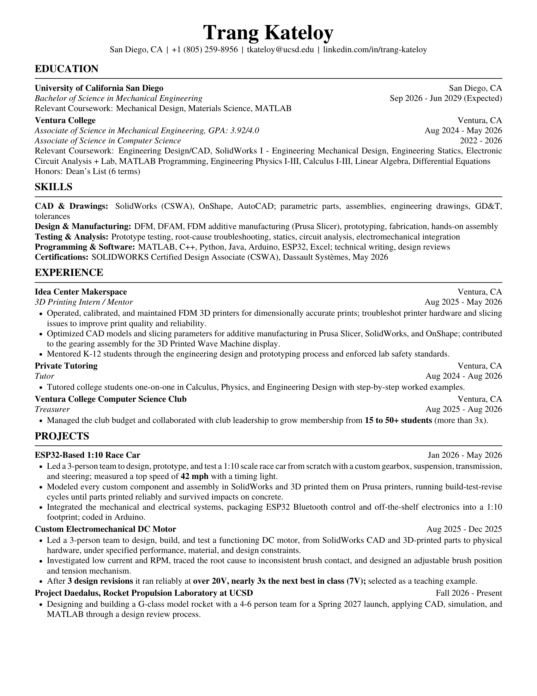

[Download PDF](/files/resume.pdf){: .btn .btn--primary} [Open in new tab](/files/resume.pdf){: .btn target="_blank"}

<iframe class="resume-embed" src="/files/resume.pdf#view=FitH" title="Trang Kateloy resume"></iframe>

