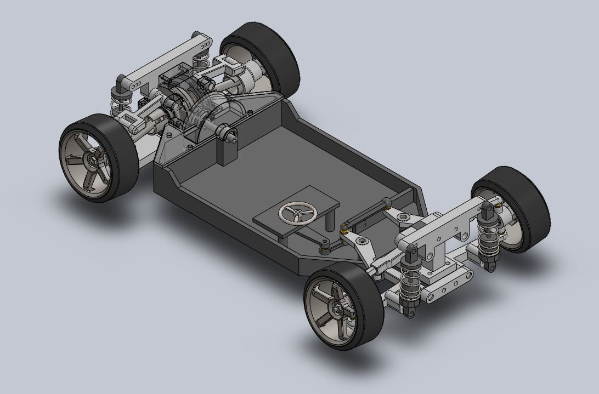
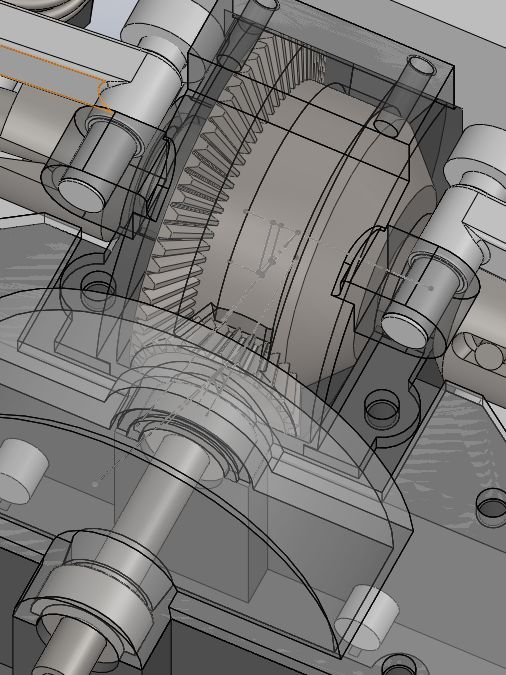
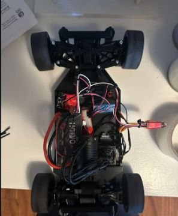

**Jan 2026 – May 2026** · SolidWorks · Prusa FDM printing · ESP32 · Arduino

## Goal
Design a low-cost, easy-to-build 1:10 scale Bluetooth RC car chassis for hobbyists that meets set material and performance limits.

## Challenges
- Making the parts print reliably
- Long-term durability
- Compatibility with off-the-shelf parts

## Solution & Results
- Led a **3-person team** that designed the car from scratch, including a **custom gearbox, suspension, transmission and steering**
- Modeled every custom part and assembly in SolidWorks and printed them on Prusa printers. We kept building, testing and revising until the parts **printed reliably and survived impacts on concrete**
- Fit ESP32 Bluetooth control and off-the-shelf electronics into the 1:10 footprint, with the code written in Arduino
- Measured a **top speed of 42 mph** with a timing light
- Served as the live demo for my Physics final project. I've since refined it so it's more consistent and easier to build

 
