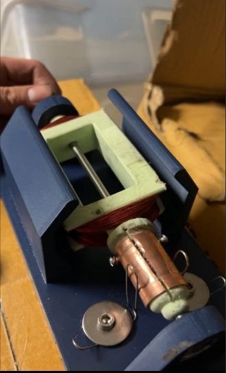
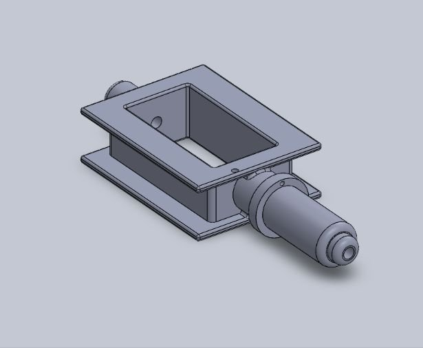
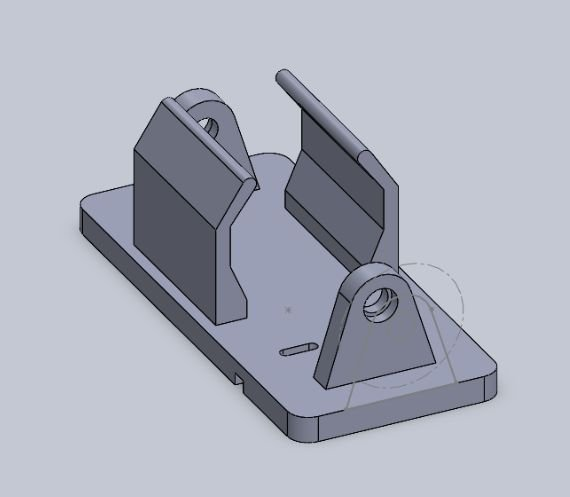

**Aug 2025 – Dec 2025** · SolidWorks · 3D printing · Root-cause troubleshooting

## Goal
Design and prototype a working DC motor from CAD models and easy-to-find materials, showing an understanding of the physics, prototyping and design workflow.

## Challenges
- Designing the armature and commutator
- Inconsistent brush contact limited current and RPM
- Limits on which materials we could use

## Solution & Results
- Led a **3-person team** from SolidWorks CAD and 3D-printed parts to working hardware, within the required performance, material and design limits
- Traced low current and RPM to **inconsistent brush contact**, then designed an **adjustable brush position and tension mechanism** that kept the brushes in steady contact with the commutator
- After **3 design revisions**, it ran reliably at **over 20 V**, nearly **3× the next best in the class (7 V)**
- Selected as a **teaching example** for future classes

 
