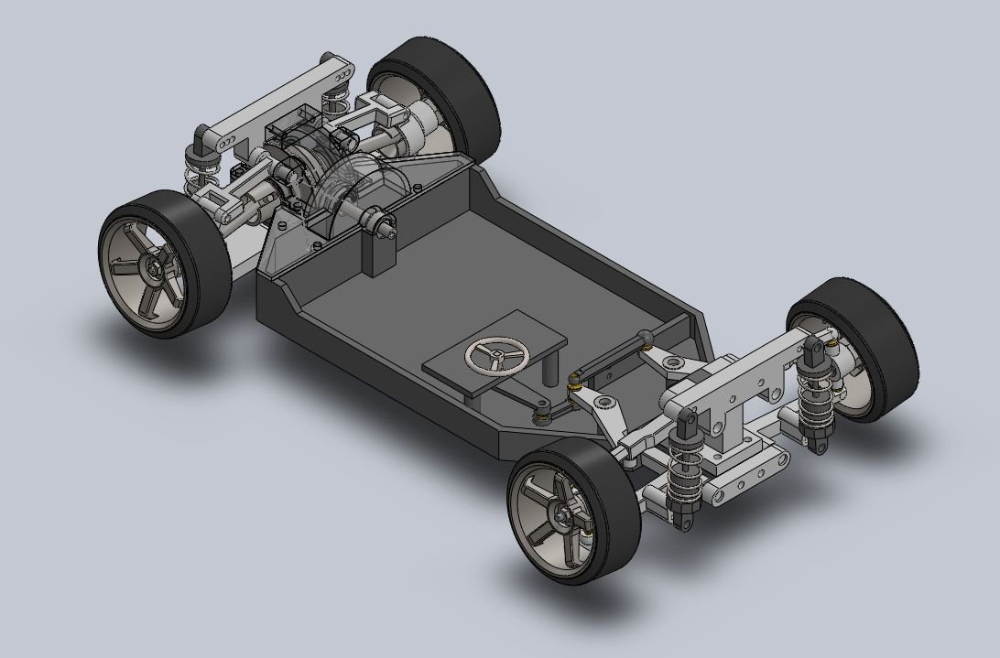
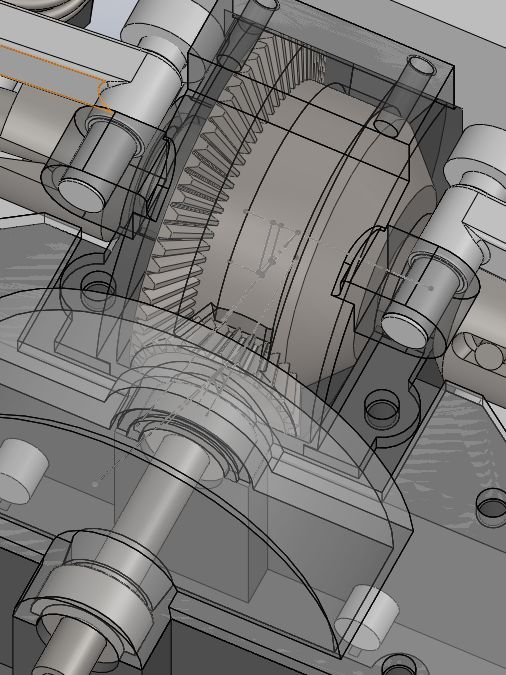
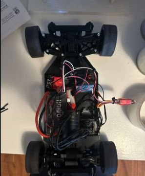

I led a 3-person team that designed, prototyped and tested a 1:10 scale race car from scratch. The goal was a low-cost, easy-to-build Bluetooth RC chassis for hobbyists that met set material and performance limits. It reached a top speed of **42 mph**, measured with a timing light.

Design
======
I modeled every custom part and assembly in SolidWorks, including the **gearbox, suspension, transmission and steering**. The parts were 3D printed on Prusa printers, and I used design-for-additive-manufacturing choices so they would print reliably and work with off-the-shelf parts.

Challenges
======
- Making the parts print reliably
- Long-term durability
- Compatibility with off-the-shelf parts

Build, Test, Revise
======
We repeated build-test-revise cycles until the parts **printed reliably and survived impacts on concrete**, with the suspension, transmission and steering still moving freely. I fit ESP32 Bluetooth control and off-the-shelf electronics into the 1:10 footprint, with the code written in Arduino.

{: width="60%"}

Results
======
The car served as the live demo for my Physics final project. Since then I've refined it so it's more consistent and easier to build.
