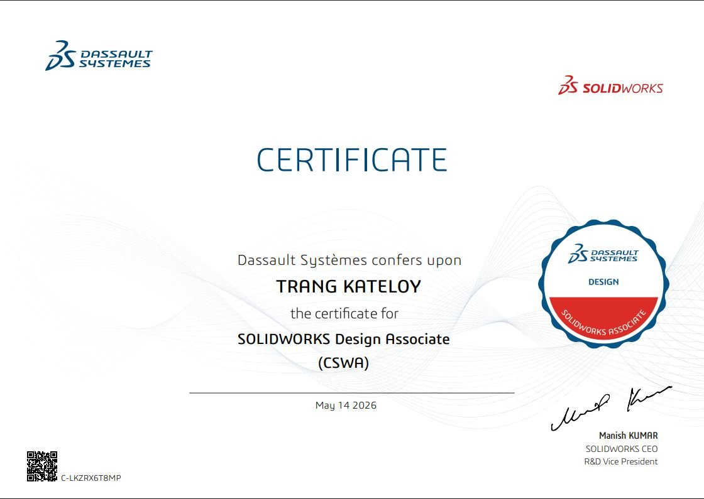

I earned this certification during my second CAD course by passing a **timed, proctored exam** given by Dassault Systèmes, the company behind SOLIDWORKS. The exam covers parametric part modeling, assemblies and reading drawings, all under time pressure. It's industry-recognized proof that I can build accurate models quickly.

{: width="70%"}

What the Course Covered
======
- Design intent, parametric modeling and fully constrained sketches
- Feature-based modeling: extrudes, revolves, sweeps, lofts, fillets and patterns
- Mate-based assemblies, configurations and interference checks
- GD&T, tolerances and fits, threads and fasteners
- Engineering drawings with section and detail views
- Design for manufacturing, mass properties and center of gravity

I've used these skills directly on my other projects.
