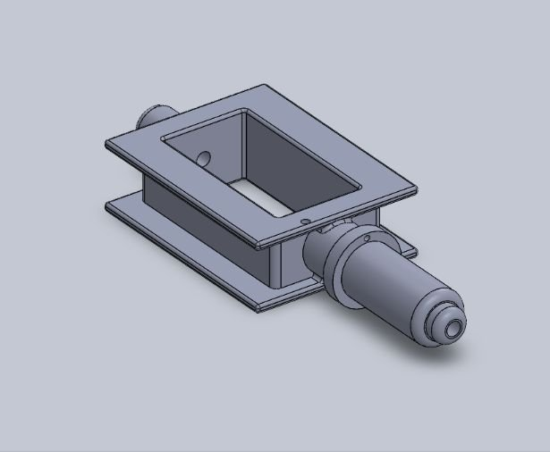
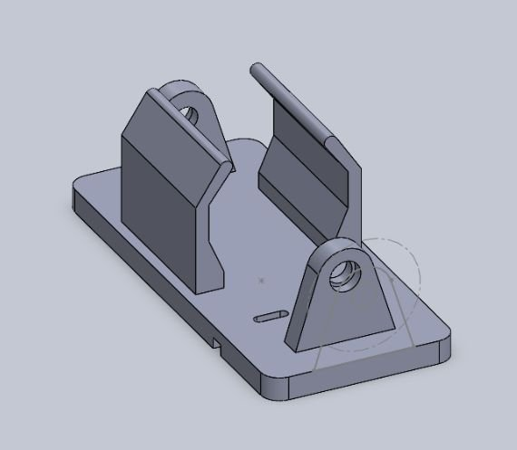
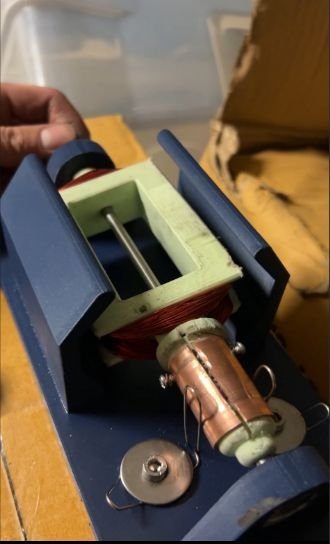

I led a 3-person team that designed, built and tested a working DC motor, from SolidWorks CAD and 3D-printed parts to physical hardware. The goal was to show an understanding of the physics, prototyping and design workflow while meeting set performance, material and design limits.

 

Challenges
======
- Designing the armature and commutator
- Inconsistent brush contact limited current and RPM
- Limits on which materials we could use

Finding the Problem
======
Early versions drew low current and spun slowly. I traced the root cause to **inconsistent brush contact** with the commutator. To fix it, I designed an **adjustable brush position and tension mechanism** that kept the brushes in steady contact, which allowed higher current and RPM.

{: width="50%"}

Results
======
After **3 design revisions**, the motor ran reliably at **over 20 V**, nearly **3× the next best in the class (7 V)**. It was selected as a **teaching example** for future classes.
